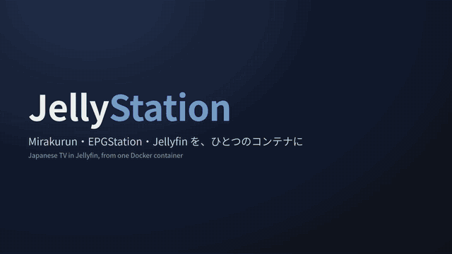

# JellyStation

English | [日本語](README.ja.md)

Japanese TV in Jellyfin from one container: **Mirakurun** (tuners), **EPGStation** (recording) and **Jellyfin**
(library and Live TV), supervised by s6-overlay.



Full video (1:21): [jellystation-demo.mp4](https://cdn.jsdelivr.net/gh/MyFeetHurt/jellystation@main/media/jellystation-demo.mp4) · Screenshots: [TV library](media/screenshot-tv.png) · [series](media/screenshot-series.png) · [Live TV guide](media/screenshot-guide.png) · [live TV](media/screenshot-live.png) · [EPGStation](media/screenshot-epgstation.png)

- Finished EPGStation recordings show up in Jellyfin's **TV** and **Movies** libraries, with titles, episode numbers,
  plots, cast, genres and thumbnails taken from the EPG (NFO files). They are hardlinks, so they don't use extra disk.
- When EPGStation finishes an encode, the encoded file replaces the TS in the library. When you delete a recording in
  EPGStation, it leaves the library too.
- Jellyfin **Live TV** uses Mirakurun's channels, numbered like a TV (1.1 NHK総合, 101.1 NHK BS) and with their logos,
  and its EPG (XMLTV) is the programme guide. Movies, sports, news and kids programmes are tagged from the ARIB genres.
- ARIB captions become subtitle files next to each recording (`.ja.srt`, optionally `.ja.ass`), so every Jellyfin
  client can show them.
- Schedule recordings without leaving Jellyfin: the [EPGStation plugin](https://github.com/MyFeetHurt/jellyfin-plugin-epgstation)
  is installed and connected to the bundled EPGStation (guide, search, reservations and rules, for every user).
- Includes a fix for Jellyfin 12, which otherwise can't play Japanese broadcast TS (see [Notes](#notes)).

## What you need

- A PC or NAS with **x86-64 Linux**. Tested on Ubuntu 24.04 and 26.04, Debian 13, Fedora 44, TrueNAS 25.10 and
  OpenMediaVault 8. Windows, macOS and ARM boards (Raspberry Pi) can't use tuners in a container: see
  [Other systems](#other-systems).
- A **tuner** that works on Linux (see [Tuners](#tuners)), connected to your aerial (and dish for BS/CS).
- A **B-CAS card** and a USB **smart card reader** (NTT Communications SCR3310, ACS ACR39 and similar). The card slot
  built into some PLEX tuners doesn't work on Linux.
- Disk space: a recording takes about 7 GB per hour (terrestrial HD) to 11 GB per hour (BS).

## Install

You type the commands below in a terminal on the Linux machine (or over ssh). Commands that start with `sudo` run as
administrator and ask for your password. Each step says how to check that it worked.

### 1. Install Docker

```sh
curl -fsSL https://get.docker.com | sudo sh
sudo systemctl enable --now docker
```

This works on Ubuntu, Debian, Fedora and their relatives (Linux Mint, ...). Your distribution's own packages are
fine too: on Ubuntu `sudo apt install docker.io docker-compose-v2` (both: the second one is `docker compose`), on
Fedora `sudo dnf install docker-cli moby-engine docker-compose`.

Check: `sudo docker compose version` prints a version.

This README writes `sudo docker ...` everywhere. Without `sudo` Docker answers `permission denied while trying to
connect to the docker API`. (To leave out `sudo`, run `sudo usermod -aG docker $USER` and log in again.)

### 2. Install the tuner driver

Tuner drivers run in the Linux kernel, so they are installed on the machine itself, not in the container. Look up
your tuner in [Tuners](#tuners):

- **Earthsoft PT1/PT2/PT3, PLEX PX-S1UD and other DVB tuners** need no driver: Linux has it. Skip to the check below.
- **PLEX PX-W3U4, PX-Q3U4, PX-W3PE4/5, PX-Q3PE4/5, PX-MLT, PX-M1UR, PX-S1UR, e-Better DTV02A/03A** need
  [px4_drv](https://github.com/tsukumijima/px4_drv). On Ubuntu, Debian and their relatives:

  ```sh
  sudo apt install -y dkms linux-headers-$(uname -r)
  wget https://github.com/tsukumijima/px4_drv/releases/download/v0.6.1/px4-drv-dkms_0.6.1_all.deb
  sudo apt install -y ./px4-drv-dkms_0.6.1_all.deb
  ```

  So that the driver is rebuilt after kernel updates, also install the headers package that follows them:
  `sudo apt install linux-headers-generic` (Ubuntu) or `sudo apt install linux-headers-amd64` (Debian).

  On Fedora (and other distributions without .deb packages), build it with DKMS from the source:

  ```sh
  sudo dnf install -y dkms kernel-devel-$(uname -r) gcc make git
  git clone --depth 1 --branch v0.6.1 https://github.com/tsukumijima/px4_drv
  sudo cp -a px4_drv /usr/src/px4_drv-0.6.1
  sudo dkms add px4_drv/0.6.1 && sudo dkms install px4_drv/0.6.1
  ```

  Ubuntu only: when the PC uses **Secure Boot**, the installation shows a blue "Configuring Secure Boot" screen that
  asks for a password. Choose one (8 characters or more) and write it down: you need it once after the next reboot
  (see below).

Check: connect the tuner (USB tuners: unplug and plug in again after installing the driver), then

```sh
ls /dev/px4video* /dev/pxmlt* /dev/pxm1ur* /dev/pxs1ur* /dev/isdb* /dev/dvb 2>/dev/null
```

lists your tuner (`/dev/px4video0` ... for px4_drv tuners, `/dev/dvb` for PT3 and DVB tuners). When it lists
nothing, run `sudo modprobe px4_drv` (px4_drv tuners) and read what it says:

- `Key was rejected by service`: **Secure Boot** refuses the self-built driver. Tell the firmware to trust the
  driver's key once:

  ```sh
  sudo mokutil --import /var/lib/shim-signed/mok/MOK.der   # Ubuntu
  sudo mokutil --import /var/lib/dkms/mok.pub              # Debian, Fedora and others
  ```

  (Only one of the two files exists on your machine: `ls /var/lib/shim-signed/mok/MOK.der /var/lib/dkms/mok.pub`.)

  Choose a one-time password, then `sudo reboot` and stay at the screen: a blue **Shim UEFI key management** screen
  waits **10 seconds** for a key press. Press a key, then choose **Enroll MOK** → **Continue** → **Yes**, type the
  password, and **Reboot**. If you miss the 10 seconds, the request is dropped: run the `mokutil` command again and
  reboot. (Ubuntu users who chose a password in the blue screen during the installation only need the reboot.)
  Turning Secure Boot off in the firmware settings works too.
- `Module px4_drv not found`: the driver wasn't built. `sudo dkms status` should say `installed`; when it says
  `added`, the kernel headers were missing: install them (above) and run `sudo dkms autoinstall`.

### 3. Write the compose file

A **compose file** (`compose.yaml`) tells Docker how to run JellyStation: which tuners it may use and where it keeps
its data. JellyStation writes one for your machine. Make a folder for it, go into it, and run the second command
(one long line):

```sh
mkdir ~/jellystation && cd ~/jellystation
sudo docker run --rm -v /dev:/dev:ro --entrypoint jellystation-compose ghcr.io/myfeethurt/jellystation > compose.yaml
```

The first time, Docker downloads the image (about 1 GB; 3.5 GB on disk). Then it prints what it found, for example:

```
tuners: /dev/px4video0 /dev/px4video1 /dev/px4video2 /dev/px4video3
card reader: found
Jellyfin login: admin / JZZqDFBIKS4j
next: sudo docker compose up -d
```

Write down the Jellyfin password; it is also in `compose.yaml`. When it says `tuners: NONE found` or the card reader
is missing, go back to step 2 and run the command again (you can also edit `compose.yaml` by hand later, see
[The compose file](#the-compose-file)).

Everything JellyStation stores goes into this folder: `config/` (settings, databases), `cache/` and `media/`
(recordings and the Jellyfin library). For recordings on a bigger disk, change `./media` in the `volumes:` part of
`compose.yaml` to a folder on that disk, e.g. `/mnt/bigdisk/tv:/media`.

### 4. Start it

```sh
sudo docker compose up -d
```

Run it in the folder with `compose.yaml` (`cd ~/jellystation`). `-d` means it keeps running in the background, also
after you close the terminal, and it starts again by itself after a reboot.

Check: `sudo docker compose ps` says `Up` and, after a minute, `(healthy)`.

### 5. Wait for the channel scan

On the first start JellyStation looks for channels: terrestrial, BS, CS and cable TV, about an hour. The channels
appear when the whole scan is done. To follow it:

```sh
sudo docker logs -f jellystation 2>&1 | grep -E "jellystation:|Z (mirakurun|jellyfin):|found [0-9]+ tuners|card reader"
```

(Ctrl+C stops watching; JellyStation keeps running.) Mirakurun's page `http://<host>:40772` shows the scan too;
`<host>` is the address of the Linux machine (`hostname -I` shows it), e.g. `http://192.168.1.20:40772`.
When the log says `channel scan finished`, EPGStation shows the channels within about 10 minutes and their
programmes a little later. Make your first reservations after that.

### 6. Watch and record

- **Jellyfin** `http://<host>:8096`: log in as `admin` with the password from step 3. The TV and Movies libraries
  and Live TV are already set up. Add users for your family in Dashboard → Users.
- **EPGStation** `http://<host>:8888`: the programme guide; add reservations or rules (e.g. every episode of a
  series). Recordings can also be scheduled inside Jellyfin at `http://<host>:8096/EpgStation/Web/`.
- Finished recordings appear in Jellyfin a few minutes after they end.

## Everyday commands

Run them in the JellyStation folder (`cd ~/jellystation`).

| What | Command |
|---|---|
| Is it running? | `sudo docker compose ps` |
| Show the log (Ctrl+C to stop) | `sudo docker compose logs -f` |
| Stop | `sudo docker compose down` |
| Start | `sudo docker compose up -d` |
| Restart (after changing a config file) | `sudo docker compose restart` |
| Update to the newest version | `sudo docker compose pull && sudo docker compose up -d` |
| Apply changes to `compose.yaml` | `sudo docker compose up -d` |
| Show the tuners JellyStation sees | `sudo docker exec jellystation jellystation-tuners` |

`down` and updates keep your recordings, settings and reservations: they are in the folder, not in the container.
To uninstall, run `sudo docker compose down` and delete the folder (with the recordings in it).

## Troubleshooting

| You see | What to do |
|---|---|
| `permission denied while trying to connect to the docker API` | Put `sudo` in front of the command. |
| `no configuration file provided: not found` | You are not in the folder with `compose.yaml`: `cd ~/jellystation`. |
| `empty compose file` | The command in step 3 failed and left an empty file: run it again and read its message. |
| `error while creating mount source path '/srv/...': read-only file system` | Docker was installed as a snap (Ubuntu Server's installer offers it), which may only use folders in your home and `/mnt`. Keep the data there, or remove the snap (`sudo snap remove docker`) and install Docker as in step 1. |
| `error gathering device information while adding custom device "/dev/px4video0": no such file or directory` | A device in `compose.yaml` doesn't exist (tuner unplugged, driver not loaded: step 2). Fix that, or remove the line. |
| `modprobe: ERROR: could not insert 'px4_drv': Key was rejected by service` | Secure Boot: enroll the driver key (step 2). |
| `mkdir: cannot create directory '/config/...': Permission denied` (Fedora, RHEL) | SELinux: add `:z` after each folder in `volumes:` (`./config:/config:z`). `jellystation-compose` does that by itself. |
| `no tuner devices found` in the log | The tuners weren't passed to the container. Write `compose.yaml` again (step 3), then `sudo rm config/mirakurun/tuners.yml` and `sudo docker compose up -d --force-recreate`. |
| `WARNING: no smart card reader found` / recordings and Live TV don't play | Connect the card reader with the B-CAS card in it, make sure `/dev/bus/usb` is in `devices:`, and `sudo docker compose restart`. |
| `channel scan found no channels` | No signal: check the aerial cable. The scan runs again on the next start (`sudo docker compose restart`). |
| Many `respawning because request has not closed` warnings | Normal during the channel scan (frequencies without a signal). |

## Other systems

- **TrueNAS SCALE / Community Edition** (tested with 25.10): create datasets for the config, cache and media, then
  Apps → Discover Apps → ⋮ → Install via YAML and paste a compose file with those paths (`/mnt/<pool>/...`).
  TrueNAS can't install extra kernel drivers, so only tuners whose driver is part of Linux work there: PT1/PT2/PT3
  and PX-S1UD (tested with a PT3). For px4_drv tuners (PX-W3U4, PX-Q3U4, ...), see the tuner server below.
- **OpenMediaVault** (tested with 8): it is Debian underneath, so install the tuner driver as in step 2.
  Then, with the Compose plugin from omv-extras, add a file with the compose file from step 3; in `volumes:` use
  `CHANGE_TO_COMPOSE_DATA_PATH` (the plugin's data folder) instead of `.`.
- **Windows, macOS, Raspberry Pi and other ARM boards**: the image is for x86-64 Linux, and Docker Desktop (Windows,
  macOS) can't pass tuners or card readers into a container. Use a **tuner server** instead: a machine that runs
  Mirakurun with the tuners and the card reader. JellyStation then uses its tuners over the network:
  `JELLYSTATION_REMOTE_MIRAKURUN=<tuner server>:40772` (see [Settings](#settings) and [Notes](#notes)). On Linux,
  step 3 writes such a compose file when you add `-e JELLYSTATION_REMOTE_MIRAKURUN=<tuner server>:40772` after
  `--rm`. On Windows, see [Windows](#windows-docker-desktop).

## Windows (Docker Desktop)

JellyStation runs on Windows 10/11 with Docker Desktop, using the tuners of a **tuner server**: another PC or NAS on
your network that runs Mirakurun with the tuners and the B-CAS card. (Windows can't pass tuners or card readers into
a container.)

1. Install [Docker Desktop](https://docs.docker.com/desktop/setup/install/windows-install/) (keep "Use WSL 2") and
   restart. If Docker Desktop then says **WSL not installed**, right-click Start → Terminal (Admin), run
   `wsl --install`, and restart again.
2. Start Docker Desktop from the Start menu and wait for **Engine running**. In Settings → General, turn on **Start
   Docker Desktop when you sign in to your computer**.
3. Make a folder, e.g. `C:\Users\<you>\jellystation`. Open Notepad, paste the file below, change the tuner server's
   address and the password, and save it in that folder as `compose.yaml` with **Save as type: All files** and
   **Encoding: UTF-8** (otherwise Notepad saves `compose.yaml.txt`):

```yaml
services:
  jellystation:
    image: ghcr.io/myfeethurt/jellystation:latest
    container_name: jellystation
    restart: unless-stopped
    stop_grace_period: 30s
    cap_add:
      - SYS_NICE
    environment:
      TZ: Asia/Tokyo
      JELLYSTATION_JELLYFIN_PASSWORD: change-me # Jellyfin login admin / this
      JELLYSTATION_REMOTE_MIRAKURUN: "192.168.1.10:40772" # your tuner server
      JELLYSTATION_REMOTE_TUNERS: "2"
    ports:
      - "8096:8096"
      - "8888:8888"
      - "40772:40772"
    volumes:
      - config:/config # settings and databases, inside Docker (fast)
      - cache:/cache
      - ./media:/media # recordings, in this folder; or a bigger drive: D:\TV:/media
volumes:
  config:
  cache:
```

   There is no `devices:` part on Windows. Settings and databases are kept in Docker's own storage (`config`,
   `cache`): in a Windows folder EPGStation's database is locked for minutes at a time and Jellyfin's guide takes
   most of an hour to load. Recordings stay in the `media` folder, where Explorer shows them. Don't use Linux paths
   such as `/srv/tv`: Docker Desktop keeps those in its virtual machine's memory, and they are gone after a restart.
4. Type `powershell` in the folder's address bar, press Enter, and run `docker compose up -d` (no `sudo` on
   Windows). When Windows asks whether **Docker Desktop Backend** may use the network, click **Allow**; otherwise
   your TV and phone can't reach Jellyfin.
5. The first start takes about 20 minutes (channel list from the tuner server, then the guide);
   `docker compose logs -f` shows it.
6. Open `http://localhost:8096` on the PC, or `http://<PC address>:8096` from other devices (`ipconfig` shows the
   IPv4 address).

JellyStation runs only while Docker Desktop runs, which means while someone is signed in to Windows and the PC isn't
asleep: turn sleep off (Settings → System → Power) if it should record at night. Recordings in `media\library` are
hardlinks of those in `media\recorded`: Explorer shows both, but the disk space is used once. Docker gets half of the
PC's memory; 8 GB PCs work.

## Watching away from home (Tailscale)

[Tailscale](https://tailscale.com) (free for personal use) connects your phone or laptop to your home machine
over the internet without opening ports on your router. Don't forward ports 8888 and 40772 to the internet instead:
EPGStation and Mirakurun have no login.

The easy way: install Tailscale on the Linux machine itself (`curl -fsSL https://tailscale.com/install.sh | sh`,
then `sudo tailscale up`) and in the Tailscale app on your phone; Jellyfin is then `http://<machine name>:8096`.

Or run Tailscale as a second container next to JellyStation, so the machine itself stays untouched. Add this to the
end of `compose.yaml` (the `tailscale:` part lines up with `jellystation:`; `configs:` starts at the left edge):

```yaml
  tailscale:
    image: tailscale/tailscale:stable
    container_name: jellystation-tailscale
    hostname: jellystation # its name on your Tailscale network
    restart: unless-stopped
    environment:
      TS_STATE_DIR: /var/lib/tailscale
      TS_SERVE_CONFIG: /serve.json
    configs:
      - source: tailscale-serve
        target: /serve.json
    volumes:
      - ./tailscale:/var/lib/tailscale

configs:
  tailscale-serve: # Tailscale ports 8096 (Jellyfin) and 8888 (EPGStation) lead to JellyStation
    content: |
      {"TCP": {"8096": {"TCPForward": "jellystation:8096"}, "8888": {"TCPForward": "jellystation:8888"}}}
```

Then `sudo docker compose up -d` and `sudo docker logs jellystation-tailscale 2>&1 | grep login.tailscale.com`:
open that link once and log in to Tailscale to add the machine. On your phone (Tailscale app on), the Jellyfin app
connects to `http://jellystation:8096` and EPGStation is `http://jellystation:8888`. The login is kept in
`./tailscale`.

## Tuners

| Tuners | Linux driver | In `compose.yaml` (`devices:`) |
|---|---|---|
| PLEX PX-W3U4, PX-Q3U4, PX-W3PE4, PX-Q3PE4, PX-W3PE5, PX-Q3PE5 | [px4_drv](https://github.com/tsukumijima/px4_drv) (step 2) | `/dev/px4video*` |
| PLEX PX-MLT5PE, PX-MLT8PE, PX-M1UR, PX-S1UR; e-Better DTV02A-1T1S-U, DTV02A-4TS-P, DTV03A-1TU | px4_drv | `/dev/pxmlt5video*`, `/dev/pxmlt8video*`, `/dev/pxm1urvideo*`, `/dev/pxs1urvideo*`, `/dev/isdb2056video*`, `/dev/isdb6014video*`, `/dev/isdbt2071video*` |
| Earthsoft PT1, PT2, PT3 | part of Linux (`earth_pt1`, `earth_pt3`) | `/dev/dvb` |
| Earthsoft PT1, PT2, PT3 with the older pt1_drv / pt3_drv | the out-of-tree driver | `/dev/pt1video*`, `/dev/pt3video*` |
| PLEX PX-S1UD, PX-Q1UD and other ISDB DVB tuners | part of Linux; some USB sticks need a firmware file (PX-S1UD: `isdbt_rio.inp` in `/lib/firmware`) | `/dev/dvb` |

Tested (2026-10): px4_drv 0.6.1 builds and loads on Ubuntu 24.04 (kernel 6.8) and 26.04 (7.0), Debian 13 (6.12) and
Fedora 44 (7.2), with Secure Boot on after enrolling the key; PX-Q3U4 and PT3 (`earth_pt3`) record on all of them.
`earth_pt3` is part of the normal kernels of these distributions. (Ubuntu's minimal cloud and VM kernel,
`linux-image-virtual`, leaves it out: `sudo apt install linux-generic`.)

JellyStation tunes with [recisdb](https://github.com/kazuki0824/recisdb-rs) (a recpt1 replacement written in Rust),
which descrambles with the B-CAS card through pcscd in the container. The card reader is passed in as
`/dev/bus/usb`, and the log warns when no reader is found.

**First start.** When `config/mirakurun/tuners.yml` doesn't exist, JellyStation writes one with a tuner for every
device it finds: px4_drv devices by their names (PX-W3/Q3: satellite, satellite, terrestrial, terrestrial per group
of four), DVB adapters by what their frontend reports. A new channel list is then scanned once Mirakurun runs, and
Mirakurun is restarted once with it at the end. (Mirakurun throws away its EPG whenever the channel list changes, so
restarting after each part would lose the programmes of the channels found before.) A scan that finds nothing
(aerial not connected?) runs again on the next start.

**Channels.** The scan covers terrestrial channels on UHF 13-62 and, for cable TV, on cable frequencies C13-C63
(pass-through; skip it with `JELLYSTATION_CATV=false`), plus all BS and 110° CS channels, including pay channels
such as WOWOW, Star Channel and SKY PerfecTV! e2. Pay channels play when the B-CAS card has a contract for them.
Cable TV that is only delivered through the cable company's set-top box (transmodulation) and SKY PerfecTV! premium
(124/128°) need other hardware and are not supported.

**Adding or changing tuners.** Pass the new devices (run `jellystation-compose` again, or add them to `devices:` in
`compose.yaml`) and `sudo docker compose up -d`. Then `sudo docker exec jellystation jellystation-tuners` shows what
it finds and `sudo docker exec jellystation jellystation-tuners --write` replaces `tuners.yml` (the old one is kept as
`tuners.yml.bak`); `sudo docker compose restart` afterwards. To scan the channels again, delete
`config/mirakurun/channels.yml` and `tuners.yml` before restarting, or use Mirakurun's scan API. The tuner command is
`/opt/jellystation/bin/tune DEVICE <type> <channel>`; `JELLYSTATION_RECISDB_ARGS` adds recisdb options to it (e.g.
`--lnb 15v` when the tuner powers the dish).

## The compose file

`jellystation-compose` (step 3) writes this for you. To write it yourself, keep the `devices:` lines of the tuners
you have (Docker refuses to start when a listed device doesn't exist):

```yaml
services:
  jellystation:
    image: ghcr.io/myfeethurt/jellystation:latest
    container_name: jellystation
    restart: unless-stopped
    stop_grace_period: 30s # time to finish recordings and close databases (Docker's 10 s is too short)
    cap_add:
      - SYS_NICE # Mirakurun raises its own priority
    environment:
      TZ: Asia/Tokyo
      JELLYSTATION_JELLYFIN_PASSWORD: change-me # Jellyfin login admin / this, set on the first start
    devices:
      - /dev/px4video0:/dev/px4video0 # PLEX PX-W3U4 / PX-Q3U4 / ... (px4_drv): one line per /dev/px4video*
      - /dev/px4video1:/dev/px4video1
      - /dev/px4video2:/dev/px4video2
      - /dev/px4video3:/dev/px4video3
      # - /dev/dvb:/dev/dvb       # PT1/PT2/PT3, PX-S1UD and other DVB tuners
      - /dev/bus/usb:/dev/bus/usb # B-CAS card reader
      # - /dev/dri:/dev/dri       # Intel/AMD GPU for Jellyfin hardware transcoding
    ports:
      - "8096:8096"   # Jellyfin
      - "8888:8888"   # EPGStation
      - "40772:40772" # Mirakurun
    volumes:
      - ./config:/config
      - ./cache:/cache
      - ./media:/media # recordings and the Jellyfin library: one filesystem (hardlinks)
```

On Fedora and other SELinux systems with Fedora's docker package, add `:z` to each volume (`./config:/config:z`).

## Layout

```
/config/mirakurun/    server.yml, tuners.yml, channels.yml, data/
/config/epgstation/   config/config.yml, data/ (SQLite), thumbnail/, logs/
/config/jellyfin/     Jellyfin data, config and logs
/config/jellystation/      librarian state, Jellyfin API key (and generated admin password)
/cache/               Jellyfin cache and transcodes
/media/recorded/      EPGStation recordings: <title> 2026-10-10 13-15.ts (title, date, start time; no seconds)
/media/encoded/       EPGStation encodes
/media/library/TV/    TV/<Show>/<Show> - 2026-10-10 1315 - <subtitle>.ts + .nfo + -thumb.jpg + .ja.srt,
                      tvshow.nfo, poster.jpg / landscape.jpg / fanart.jpg (from an episode thumbnail)
/media/library/Movies/  Movies/<Title> (<Year>)/<Title> (<Year>).ts + .nfo
```

Config files are only written when they don't exist, so your changes are kept.

## Settings

| Variable | Default | |
|---|---|---|
| `TZ` | `Asia/Tokyo` | time zone (EPGStation file names, guide) |
| `JELLYSTATION_JELLYFIN_USER` / `JELLYSTATION_JELLYFIN_PASSWORD` | `admin` / random | Jellyfin admin created on first start; a random password is written to `/config/jellystation/jellyfin-admin.txt` |
| `JELLYSTATION_LANGUAGE` | `ja` | Jellyfin UI and metadata language |
| `JELLYSTATION_SERVER_NAME` | `JellyStation` | Jellyfin's server name, set on the first start |
| `JELLYSTATION_TV_LIBRARY_NAME` / `JELLYSTATION_MOVIE_LIBRARY_NAME` | `テレビ番組` / `映画` (`TV` / `Movies` in other languages) | names of the libraries created on the first start |
| `JELLYSTATION_JELLYFIN_SETUP` | `true` | `false`: don't touch Jellyfin's setup (the library refresh still needs `/config/jellystation/jellyfin.key`) |
| `JELLYSTATION_LIVETV` | `true` | add Mirakurun as Jellyfin Live TV tuner and guide |
| `JELLYSTATION_EPGSTATION_PLUGIN` | `true` | install the Jellyfin EPGStation plugin on the first start and connect it to the bundled EPGStation; its repository is added so Jellyfin updates it. Uninstalling it in Jellyfin is permanent |
| `JELLYSTATION_LIVETV_DUPLICATES` | `false` | `true`: also list subchannels that only simulcast another channel (MBS2, MBS3, ...) |
| `JELLYSTATION_TV_ONLINE_METADATA` | `false` | `true`: let Jellyfin look up TV shows online (EPG titles often match the wrong show) |
| `JELLYSTATION_SUBTITLES` | `srt` | ARIB captions as sidecar files: `srt` (plain text, any client), `ass` (keeps position and colour; Jellyfin's web player needs a Japanese fallback font for it), `both`, or `false` |
| `JELLYSTATION_PREFER` | `encoded` | which file goes into the library: `encoded` (when there is one) or `ts` |
| `JELLYSTATION_SYNC_INTERVAL` | `600` | seconds between library checks (EPGStation also triggers one when a recording or encode ends) |
| `JELLYSTATION_ALLOW_MASS_DELETE` | `false` | the librarian refuses to remove more than half of the library in one pass (e.g. after an EPGStation database reset) unless this is `true` |
| `JELLYSTATION_REMOTE_MIRAKURUN` | | `host:port` of another Mirakurun that has the tuners (and the B-CAS card). On first start the container's Mirakurun gets remote tuners that let that server descramble, and copies its channel list; EPGStation is configured to use that Mirakurun directly (see Notes) |
| `JELLYSTATION_REMOTE_TUNERS` | `2` | number of remote tuner slots |
| `JELLYSTATION_EPGSTATION_REC_PRIORITY` / `JELLYSTATION_EPGSTATION_CONFLICT_PRIORITY` | EPGStation's (2 / 1) | tuner priorities for a new `config.yml`, e.g. lower them when sharing a tuner server with another EPGStation |
| `JELLYSTATION_CATV` | `true` | also scan cable TV frequencies (C13-C63) on the first start |
| `JELLYSTATION_LIVE_PROBESIZE` | `10M` | how much of a live stream Jellyfin's ffmpeg/ffprobe read before starting (see Notes) |
| `JELLYSTATION_RECISDB_ARGS` | | extra recisdb options for local tuners, e.g. `--lnb 15v` |
| `JELLYSTATION_PCSCD` | `auto` | start pcscd when `/dev/bus/usb` is passed in; `false` to disable |

Mirakurun's own Docker variables (`LOG_LEVEL`, `EPG_GATHERING_JOB_SCHEDULE`, `LOGO_DATA_INTERVAL`, ...) work as usual.

## Build

The image on ghcr.io is built from this repository by GitHub Actions (`latest` = main, `X.Y.Z` = releases). To build
it yourself:

```sh
docker build -t jellystation .
# versions: --build-arg JELLYFIN_VERSION=12.2 EPGSTATION_VERSION=v2.10.0 MIRAKURUN_VERSION=4.1.5 RECISDB_VERSION=1.3.0
```

## Notes

- **Jellyfin 12 and Japanese TS.** Broadcast TS contains streams that ffprobe can't identify (`codec_type` missing).
  Jellyfin 12.2 fails while reading them (`Nullable object must have a value` in `ProbeResultNormalizer.GetAspectRatio`),
  loses all stream information and then sends MPEG-2 unconverted, which browsers can't play. The image's ffprobe
  (`/opt/jellystation/ffmpeg/ffprobe`) leaves those streams out of the result. Jellyfin 10.11 doesn't need this.
- **Live TV start-up.** Jellyfin opens live streams with `-probesize 1G`, and ffprobe/ffmpeg keep reading until they
  have identified every stream, which the ARIB data streams never are: live playback waited minutes. The image's
  ffprobe and ffmpeg wrappers use 10 MB for live (http) inputs (`JELLYSTATION_LIVE_PROBESIZE`); playback starts in
  about 10 seconds.
- File names and metadata come from the EPG. EPG text is inconsistent, so some show names will be imperfect. To fix a
  show's folder, set a directory in its EPGStation rule: the rule's directory becomes the show name.
- **Remote tuners.** EPGStation learns programmes from Mirakurun's event stream, and EPG that one Mirakurun copies
  from another produces no events. So with `JELLYSTATION_REMOTE_MIRAKURUN`, EPGStation talks to the tuner server's
  Mirakurun, and the container's Mirakurun feeds Jellyfin Live TV. On first start the channel scan takes about 15
  minutes with two remote tuners; when it is done, the EPG gatherer is started once so the guide doesn't wait for
  Mirakurun's next :20/:50 run. Channel logos come from tuning each channel (Mirakurun's `LOGO_DATA_INTERVAL`); with
  remote tuners that ties up the tuner server's tuners, so `LOGO_DATA_INTERVAL: "999999999"` (no logos) is a good
  idea when the tuner server also records for others.
- Mirakurun, EPGStation and Jellyfin run unmodified; JellyStation only adds configuration and its own helper scripts.
- **Captions.** jellyfin-ffmpeg has no ARIB caption decoder, so the image adds a static ffmpeg from
  [BtbN/FFmpeg-Builds](https://github.com/BtbN/FFmpeg-Builds) (`/opt/ffmpeg-arib`, with libaribcaption) that only
  the librarian uses. Captions are decoded with `-fix_sub_duration` (ARIB captions have no duration). Live TV has no
  captions. Changing `JELLYSTATION_SUBTITLES` adds the new files to recordings already in the library.

## Development

`dev/compose.yaml` runs the stack with another Mirakurun as remote tuners. `node --test tests/*.test.js` runs the librarian tests.
`tools/jf_playtest.py` checks that Jellyfin can transcode every video, and `tools/e2e_record.py` records one short
programme and checks that it reaches the library. `tools/epgs_import.py` copies finished recordings from another
EPGStation (programme data and the TS) into a test stack. `dev/compose.local.yaml` runs a second stack with local tuners.

## Credits

[Mirakurun](https://github.com/Chinachu/Mirakurun), [EPGStation](https://github.com/l3tnun/EPGStation),
[Jellyfin](https://jellyfin.org), [recisdb](https://github.com/kazuki0824/recisdb-rs),
[s6-overlay](https://github.com/just-containers/s6-overlay). EPG naming is ported from
[epgXport](https://github.com/MyFeetHurt/epgXport); scheduling in Jellyfin is
[jellyfin-plugin-epgstation](https://github.com/MyFeetHurt/jellyfin-plugin-epgstation).

## License

MIT (JellyStation's own scripts and configuration). The image also contains Mirakurun (Apache-2.0), EPGStation (MIT),
Jellyfin (GPL-2.0), recisdb (GPL-3.0), FFmpeg (GPL), s6-overlay (ISC) and the EPGStation plugin (GPL-3.0), each under
its own license.
